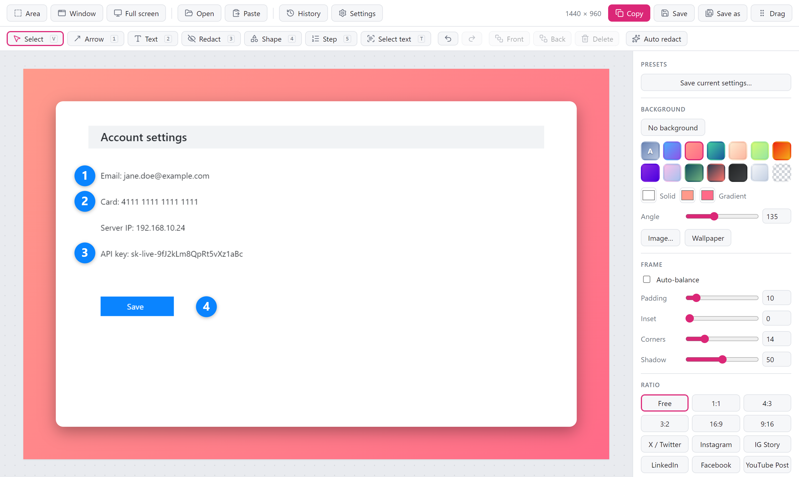
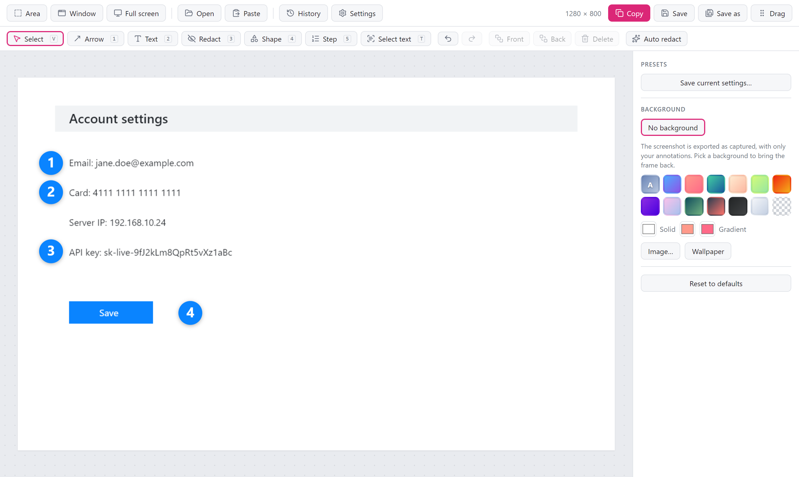

  

# Lumela 0.2.0: numbered steps, and screenshots without the frame

If you write guides, file bug reports or explain things to colleagues, this release is for you. You can now number the steps on a screenshot with a single click each, and share a screenshot exactly as you took it when a background would only get in the way.

## Numbered steps

Press <kbd>5</kbd> and click wherever something happens: 1, 2, 3, in the order you click. No text boxes to line up, no counting.

- **Delete a step and the rest move up.** Remove step 2 and step 3 becomes step 2, so you never end up with 1, 3, 4. Undo puts everything back.
- **Readable on any colour.** Pick a colour and size from the toolbar. The number turns white or black to stay readable, and two-digit steps still fit.
- **Like everything else in the editor.** Move, resize, restyle, undo. Steps are saved with the screenshot in your history.

## No background, when you don't want one

Lumela frames every screenshot with a background, padding and a soft shadow, which is great for a tweet or a blog post. For a bug report, a wiki page or a quick message to a teammate, you often want the screenshot as it is.

Click **No background** and you get exactly that: the screenshot at its original size, with your arrows, text, steps and blurs on top. No margin, no rounded corners, no black edges in a JPEG. Pick any background to bring the frame back with the settings you had.

Your choice carries over to the next screenshots, and you can save it as a preset, so plain screenshots can be your default.

  

## Auto redact knows your own words

Auto redact already hides emails, card numbers, IP addresses and API keys. Now you can teach it what else is private for you: your company's name, customer names, project codes, internal hostnames. Add them in **Settings → Text recognition**, one per line, and they are covered along with everything else. Case does not matter, and `acme` also catches `acme-prod-db`.

Thank you @fate-lab for building this one.

## Also in this release

- The background colours in the side panel fit again. The last column used to be cut off.

## Download

| Your system | Download |
|---|---|
| **Windows 10 / 11** | `Lumela_0.2.0_x64-setup.exe` (recommended) or `Lumela_0.2.0_x64_en-US.msi` |
| **macOS** (Apple silicon and Intel) | `Lumela_0.2.0_universal.dmg` |
| **Linux** (x64): Ubuntu 24.04+, Debian 13+, Fedora 40+ or similar | `Lumela_0.2.0_amd64.AppImage` or `Lumela_0.2.0_amd64.deb` |

Already using Lumela? It updates itself. You can also install with Homebrew (`brew trust tw4/tap && brew install --cask tw4/tap/lumela`) or Scoop.

New to Lumela? It is a free, open-source screenshot tool for Windows, macOS and Linux. Capture, make it look good, point things out, hide what is private, and share. No account, no subscription, no watermark, and nothing leaves your computer.

### First launch

Installers are not code-signed yet, so the operating system warns on first launch.

- **Windows:** *More info* → *Run anyway*.
- **macOS 15 and later:** open Lumela once and close the warning, then **System Settings → Privacy & Security → Open Anyway**. Installing with Homebrew skips this step.

## Help shape the next release

- If Lumela saves you time, a ⭐ on GitHub helps other people find it.
- Missing something? [Suggest a feature](https://github.com/tw4/lumela/issues/new/choose) or start a [discussion](https://github.com/tw4/lumela/discussions). Both features in this release started as ideas like that.
- Lumela speaks English and Turkish. [Adding your language](https://github.com/tw4/lumela/blob/main/CONTRIBUTING.md#translations) takes one file.
