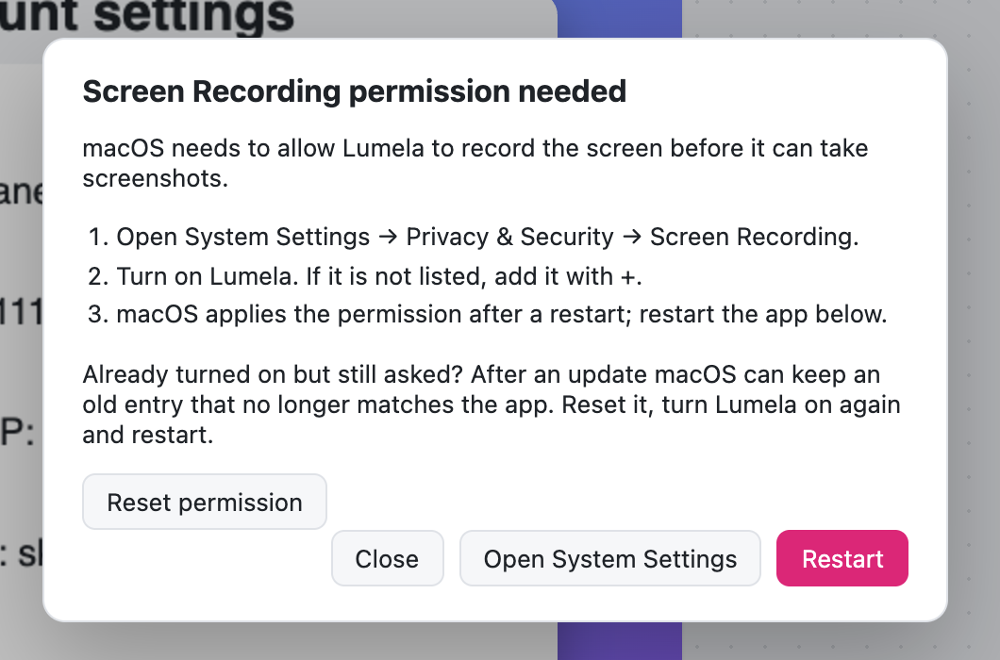

  

# Lumela 0.2.1: macOS stops asking for permission you already gave

You turned Lumela on under **Screen Recording**. You restarted it. macOS still said Lumela needs permission, and screenshots would not start. If that happened to you, this release fixes it.

## What was wrong

macOS remembers a Screen Recording grant together with a fingerprint of the app. The macOS build of Lumela was not signed as a whole app, only its main program file was, so that fingerprint did not match the app you were running, and it changed with every update. System Settings kept showing Lumela as allowed while macOS quietly refused it. Turning the switch off and on again did not help, because the old entry stayed.

## What changed

- **The macOS app is now signed as a complete bundle.** macOS recognises it as `app.lumela.desktop`, and a grant you give is kept for that install.
- **Reset permission, right in the dialog.** If macOS ever holds on to an old entry again, for example after an update, Lumela tells you why and gives you a **Reset permission** button. One click clears the stale entry and opens System Settings, so you can turn Lumela on and get back to work. No Terminal needed.
- **Every macOS release is checked.** A release can no longer be published if the app's signature does not verify.

Windows and Linux are unchanged.

## Updating from 0.2.0 or earlier on macOS

Lumela updates itself. Because the app is now signed differently, macOS may ask for Screen Recording one more time after this update:

1. When the permission dialog appears, click **Reset permission**.
2. Turn Lumela on in **System Settings → Privacy & Security → Screen Recording**.
3. Click **Restart**.

That's it.

## Download

| Your system | Download |
|---|---|
| **Windows 10 / 11** | `Lumela_0.2.1_x64-setup.exe` (recommended) or `Lumela_0.2.1_x64_en-US.msi` |
| **macOS** (Apple silicon and Intel) | `Lumela_0.2.1_universal.dmg` |
| **Linux** (x64): Ubuntu 24.04+, Debian 13+, Fedora 40+ or similar | `Lumela_0.2.1_amd64.AppImage` or `Lumela_0.2.1_amd64.deb` |

Already using Lumela? It updates itself. You can also install with Homebrew (`brew trust tw4/tap && brew install --cask tw4/tap/lumela`) or Scoop.

## New to Lumela?

Lumela is a free, open-source screenshot tool for Windows, macOS and Linux, in the spirit of CleanShot.

- **Looks good straight away.** Every capture gets a matching background, balanced padding, rounded corners and a soft shadow. Or none of it, with one click.
- **Explain without typing.** Arrows, text, shapes and numbered steps (1, 2, 3, in the order you click).
- **Private by default.** Emails, card numbers, IP addresses, API keys and your own private words are blurred automatically, on your device. Nothing is uploaded.
- **Copy text from any screenshot.** Select it like in a document.
- **Free, all of it.** No account, no subscription, no watermark.

### First launch

Installers are not code-signed with a vendor certificate yet, so the operating system warns on first launch.

- **Windows:** *More info* → *Run anyway*.
- **macOS 15 and later:** open Lumela once and close the warning, then **System Settings → Privacy & Security → Open Anyway**. Installing with Homebrew skips this step.

## Help shape the next release

- This fix started with a user who granted the permission and was still asked. If something in Lumela gets in your way, [open an issue](https://github.com/tw4/lumela/issues/new/choose). Small reports lead to fixes like this one.
- If Lumela saves you time, a ⭐ on GitHub helps other people find it.
- Lumela speaks English and Turkish. [Adding your language](https://github.com/tw4/lumela/blob/main/CONTRIBUTING.md#translations) takes one file.
